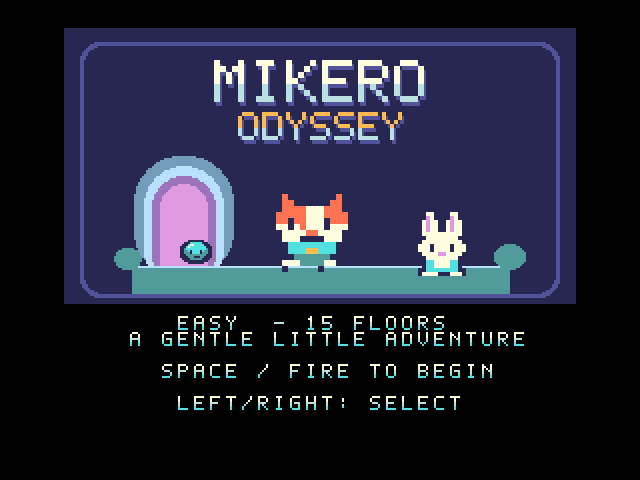
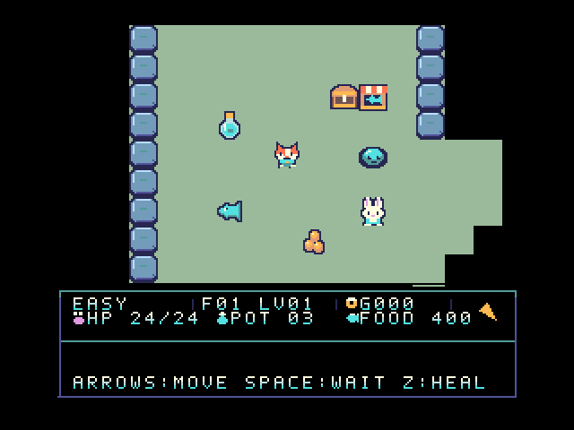
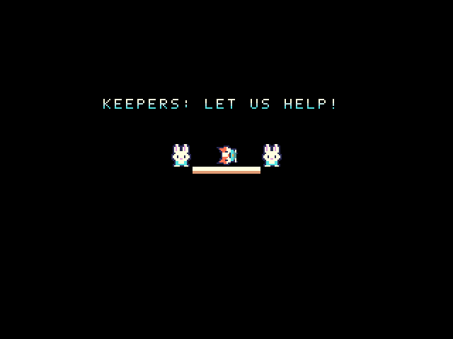

# MIKERO-ODYSSEY MSX2+ v0.1.7

MSX2+向けの公開試作版です。Z80で動作し、R800は使用していません。
[配布ZIP](https://github.com/kanon-ai/MIKERO-ODYSSEY/releases/tag/msx2plus-v0.1.7) · [MSX版](../README.md)

SCREEN 5のカラフルなタイルとキャラクター、落ち着いた床、暗い視野外の壁を採用。
V9958の縦横スクロールを使い、1マスを8ピクセルずつ2段階で移動します。
音楽はOPLLの主旋律・和音・低音、効果音はPSG。行動に合わせて音楽が進み、停止後に静かになります。
下部はアイコン付き情報パネル。走査線の表示切り替え中は黒くして境目の乱れを軽減しています。

## v0.1.7の変更

- スクロールを8段階から2段階へ変更し、タイル走査と固定パネルの描画処理を最適化。
- 敵の表示位置はスクロール完了後に更新。追跡する敵が主人公の旧位置に先に重なる現象を修正。
- 救出時のミケロ・Keeper・担架の背景を黒に修正。
- 入力リピートの設定、ゲームルール、音楽は維持しています。

| 同じ通路での1マスの移動時間 | v0.1.4 | v0.1.7 |
| --- | ---: | ---: |
| 60Hz | 約0.375秒 | 約0.200秒 |
| 50Hz | 約0.400秒 | 約0.200秒 |

openMSX / Z80、敵なしの確認用通路で長押し継続移動の中央値を比較。実機や全場面での速度保証ではありません。

## 必要環境と起動

- MSX2+ / V9958、RAM 64KB以上、VRAM 128KB、512KB ASCII16 ROM。
- 音楽にはMSX-MUSIC（YM2413 / OPLL）が必要です。MSX2+でも非搭載機があります。
- 初代MSX / MSX2向けROMではありません。
- ZIPを展開して `START.cmd`。外部のopenMSXとC-BIOSが必要です。BIOS・エミュレータは同梱しません。
- 別のエミュレータではROMをASCII16として読み込みます。旧版のセーブステートは使わず新規起動してください。

## 操作とルール

左右でEASY / NORMAL / HARD、SPACEで開始。
方向キーで移動・肉球、SPACEで待機、Zで回復。Keeper・ショップは隣から方向入力。
結果画面はSPACEでNEW GAME、Xでタイトルへ。
EASYは15階、NORMAL/HARDは30階。HARDは鍵を取ってから階段を降ります。
[基本ルール・世界観](../docs/manual-ja.md)はMSX版と共通です。

## 検証範囲

openMSX / C-BIOS / Z80で確認しています。
[最終ROMの速度・短押し・縦横移動](speed-check.json) · [救出画面の床色除去](rescue-floor-check.json) · [最新ROMの収録記録](media-check.json)

救出背景の追加修正前に、上下左右・50/60Hzで敵の描画順序を検証し、音楽・回復・HARDの鍵・階移動・救出・再開・門閉鎖など36項目を確認しました。
これらの記録は当時のROMハッシュを保持しています。最終ROMでは救出背景と移動速度を再確認しています。
[敵の重なり修正](pre-rescue-actor-scroll-check.json) · [36項目の回帰検証](pre-rescue-verification.json)

GIFはこの配布ROMを通常のキー操作で収録した実速度・無音の画像です。
[OPLL・PSGの収録音声](opll-gameplay.wav)も同じ操作時のものです。
実機・各社純正BIOS・blueMSXでの動作と見え方、30階の連続プレイ全体は未検証です。
MSX1版と同等の移動速度にはまだ達していません。ちらつきの完全解消を保証するものではありません。

## ソースとビルド

Python 3 + Pillow、SDCC Z80を使用します。
このフォルダーで `python work/source/build.py` を実行してください。
必要に応じて `SDCC_BIN` をSDCCのbinディレクトリに設定します。
生成ROMは `outputs/MIKERO-ODYSSEY.rom` です。
